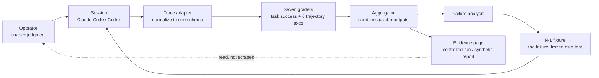

# Operating graph

The automated loop in this lab closes through grading (node `G`), not through publishing
volume. The only human edges are the operator setting the goal and reading the result. Here is
the active `agent-harness` loop as a graph; `docs/architecture.md` covers the same loop in
prose.

## The graph

Node `G` is seven graders, each reading one trace and one criterion — never the aggregate
result of another grader. The adapter before it and the aggregator after it do no scoring. An
**N-1 fixture** is the failing case itself, frozen into a new test — not a summary of what went
wrong, the exact input that caused it, kept so a fix can be checked against it.

## Why this shape

This lab has no publishing node. One full pass produces a graded report and, when the report
exposes a gap, a new fixture — not a post, a score, or a chart meant to stand alone. That's a
deliberate constraint: the loop closes on grading, not on audience metrics (stars, replies,
clicks). A separate eval in this repo applies the same principle to its own measurement — when
RegEval's held-out set turned out to duplicate tuning data, the claim was invalidated and
documented rather than quietly replaced
([RegEval case study](../evals/regeval/README.md)).

## What is not in this graph

- No autonomous dispatcher that reassigns graders to new criteria on its own — criteria changes
  are authored, reviewed, and committed like code.
- No channel-publishing layer. Distribution of results, if any, is a separate, manual decision
  outside this repository.
- No claim that one graded trace generalizes to a population-level reliability number — see
  ["What this is not"](../README.md#what-this-is-not) in the README.

## Related

- [Architecture and method](architecture.md) — the textual walkthrough of the same loop
- [Privacy model](privacy.md) — what stays local vs. what a grading call sends to a provider
- [RegEval case study](../evals/regeval/README.md) — a different eval, same discipline: the
  lab invalidated its own held-out claim rather than replacing it silently
